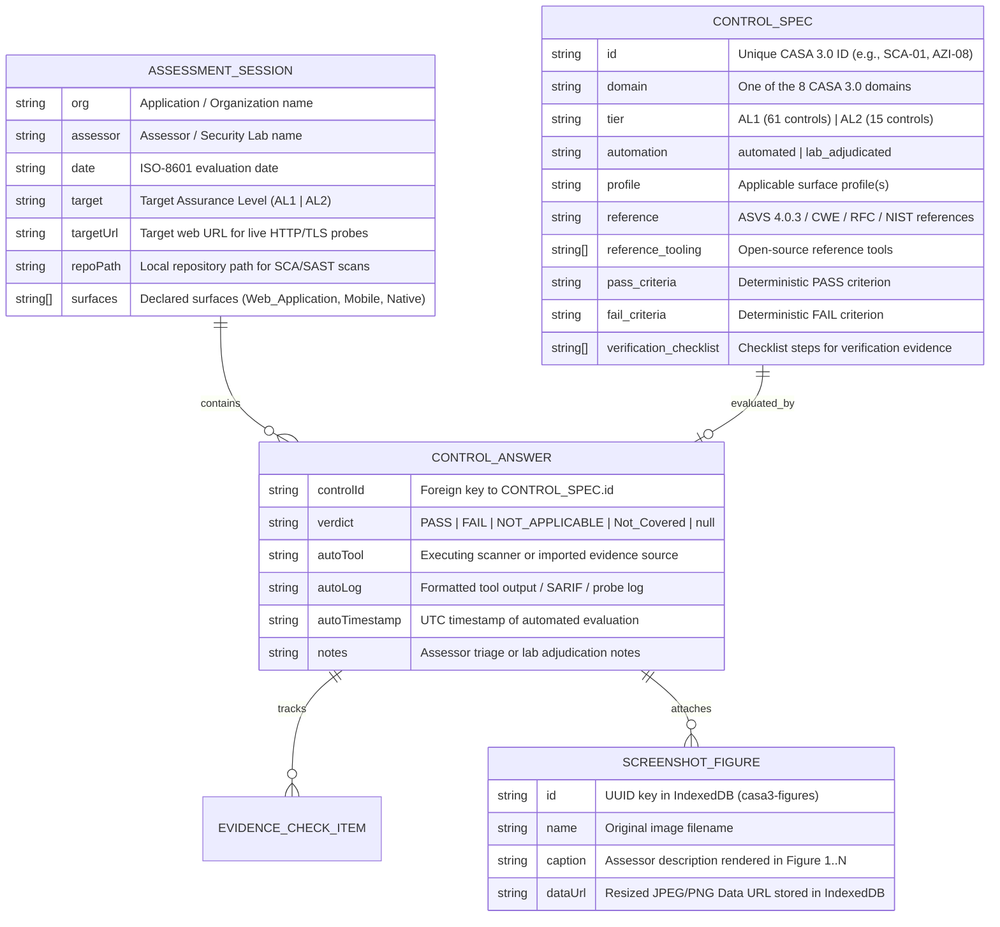

# Phase 1 Data Model: CASA 3.0 Assessment Framework

**Feature**: `001-casa3-assessment` | **Date**: 2026-11-16

---

## 1. Entity Relationship Diagram



---

## 2. Storage & Persistence Schema

### 2.1. `casa-assessment/data/casa3_controls.json` (Static Specification Bundle)
Compiled deterministically by [`build_casa3_data.py`](file:///home/user/felipe/speckit/casa/casa-assessment/scripts/build_casa3_data.py) from `CASA/CASA 3.0 *.md`:
- `standard`: `"App Defense Alliance CASA"`
- `version`: `"3.0 (2026-10-16)"`
- `domains`: Array of the 8 canonical domain names.
- `assurance_levels`: Metadata for `AL1`, and `AL2`.
- `controls`: Array of 76 `ControlSpec` objects (61 `AL1` + 15 `AL2`).

### 2.2. Browser `localStorage` (`casa3-assessment-v1`)
Stores the active session metadata and per-control evaluation state:
```json
{
  "meta": {
    "org": "Acme Web Portal v2.4",
    "assessor": "Master's Research Lab",
    "date": "2026-11-16",
    "target": "AL2",
    "targetUrl": "https://app.example.com",
    "repoPath": "/home/user/felipe/speckit/casa",
    "surfaces": ["Web_Application"]
  },
  "answers": {
    "SCA-01": {
      "verdict": "PASS",
      "autoTool": "syft + osv-scanner",
      "autoLog": "[PASS] Zero reachable Critical/High CVEs...",
      "autoTimestamp": "2026-11-16 21:20:00 UTC",
      "notes": "",
      "evidence": {},
      "figures": []
    },
    "AZI-08": {
      "verdict": "FAIL",
      "autoTool": "",
      "autoLog": "",
      "autoTimestamp": "",
      "notes": "Tenant B user could read Tenant A invoice via GET /api/invoices/1042",
      "evidence": {
        "al2:0": true,
        "al2:1": true
      },
      "figures": [
        { "id": "f1763328000-123", "caption": "Cross-tenant GET /api/invoices/1042 returning HTTP 200", "name": "idor-proof.png" }
      ]
    }
  }
}
```

### 2.3. Browser `IndexedDB` (`casa3-figures` database, `img` object store)
Stores resized (`max 1600px`) base64 `data:image/jpeg` or `data:image/png` payloads keyed by `figure.id` so `localStorage` never hits browser quota limits.
